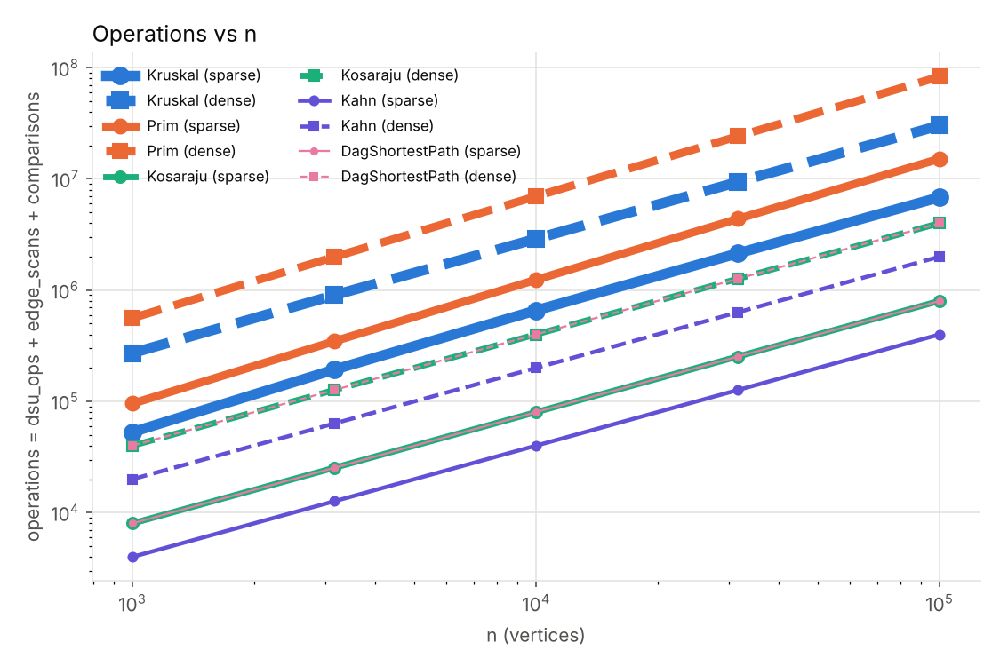
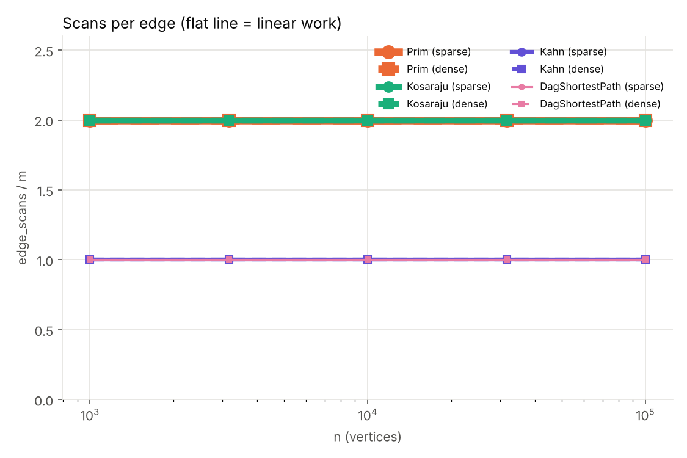
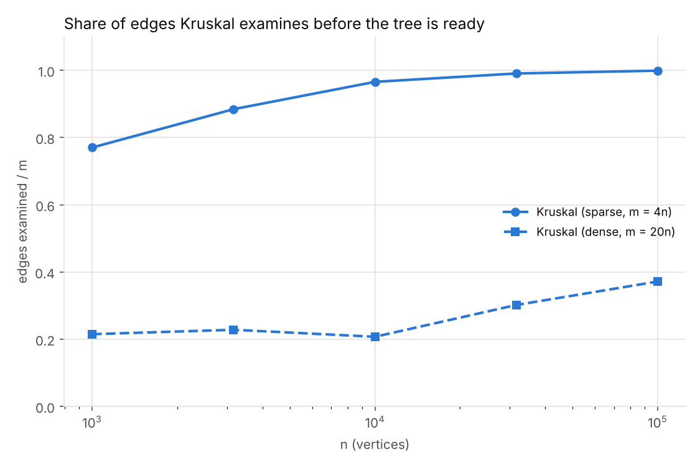

# Assignment 3 – Graphs: DSU, MST, SCC and Shortest Paths

All numbers below come from `results/results.csv` (one run of `benchmark.Benchmark`, seed 42).
The counters are counted inside the algorithms, they are the same on every machine.
The benchmark checks the reference values from the assignment on its own and stops with an
exception if one of them differs – all ten (MST weight, SCC count, sum of DAG distances) matched.

## 1. Complexity table

V = vertices, E = edges. "Extra space" is what the algorithm allocates besides the graph.

| Algorithm | Time | Extra space | Why |
|---|---|---|---|
| DSU `find` / `union` | O(α(n)) amortized | O(n) | union by rank keeps trees shallow, path compression flattens them; together the amortized cost is the inverse Ackermann function, below 5 for any real n |
| Kruskal | O(E log E) | O(V + E) | sorting E edges dominates; then at most E `union` calls at O(α(V)) each; the sorted copy and the DSU arrays |
| Prim (lazy, `PriorityQueue`) | O(E log E) = O(E log V) | O(V + E) | every edge is scanned once from each end and pushed at most once, every push/poll is O(log E); the heap can hold up to E entries |
| Kosaraju | O(V + E) | O(V + E) | two DFS passes, each edge is scanned once per pass; the reversed graph is a second copy |
| Kahn | O(V + E) | O(V) | every vertex enters the queue once, every edge is scanned once; arrays for in-degrees and the queue |
| DAG shortest paths | O(V + E) | O(V) | one pass in topological order, every edge relaxed once; `dist[]` and `parent[]` |
| Tarjan (bonus) | O(V + E) | O(V) | one DFS, every edge scanned once; `index`, `lowlink`, two stacks |

## 2. Counters vs formulas

If an algorithm really has the complexity in the table above, then (counter / formula) must stay
constant when n grows ×31 (1 000 → 100 000). The table shows that for every algorithm
(left: sparse m = 4n, right: dense m = 20n).

| n | Kosaraju scans/(V+E) | Kahn scans/(V+E) | DAG scans/(V+E) | Prim scans/2E | Kruskal dsuOps/scans examined |
|---|---|---|---|---|---|
| 1 000 | 1.600 / 1.905 | 0.800 / 0.952 | 0.800 / 0.952 | 1.000 / 1.000 | 2.324 / 2.232 |
| 3 162 | 1.600 / 1.905 | 0.800 / 0.952 | 0.800 / 0.952 | 1.000 / 1.000 | 2.283 / 2.219 |
| 10 000 | 1.600 / 1.905 | 0.800 / 0.952 | 0.800 / 0.952 | 1.000 / 1.000 | 2.259 / 2.241 |
| 31 623 | 1.600 / 1.905 | 0.800 / 0.952 | 0.800 / 0.952 | 1.000 / 1.000 | 2.252 / 2.166 |
| 100 000 | 1.600 / 1.905 | 0.800 / 0.952 | 0.800 / 0.952 | 1.000 / 1.000 | 2.250 / 2.134 |

* Kosaraju scans exactly 2E, Kahn and the DAG relaxation exactly E, Prim exactly 2E (every edge from both ends),
  so these ratios are constant to three digits. The value is not 1 only because V + E is not the
  number the algorithm scans; it depends on the density and not on n.
* Kruskal: the work is two `find` calls for every edge it examines plus one successful union per tree edge,
  so `dsuOps / edges examined` is ≈ 2 + (V−1)/examined and stays between 2.13 and 2.32. That is the
  empirical α(n): the cost per `find` does not grow with n.
* **The formula `dsuOps / E` from the assignment is not flat on the dense graphs** (0.48, 0.51, 0.47, 0.65, 0.79).
  This is not a DSU problem: Kruskal stops when the tree is ready, and on dense graphs the share of
  edges it has to examine grows with n (section 4). On the sparse graphs it is almost flat at the end
  (2.02, 2.18, 2.23, 2.25 for n ≥ 3 162) because Kruskal examines nearly all edges.
* Sorting: `comparisons / (E·log₂E)` for Kruskal is 0.89 → 0.75 (sparse) and 0.90 → 0.67 (dense). It slowly
  falls, which is the usual behaviour of TimSort on random data (below the E·log₂E upper bound). For Prim
  the same ratio is 1.83 → 1.93 and 1.83 → 1.89, it grows a little because the heap gets larger.
  Both are consistent with E log E, and neither is exactly constant.

## 3. Slope check (log-log)

Least-squares slope of log(counter) against log(n) over the five sizes:

| Counter | Kosaraju | Kahn | DAG paths | Prim | Kruskal |
|---|---|---|---|---|---|
| edgeScans, sparse | 1.000 | 1.000 | 1.000 | 1.000 | **1.055** |
| edgeScans, dense | 1.000 | 1.000 | 1.000 | 1.000 | **1.119** |
| all operations, sparse | 1.000 | 1.000 | 1.000 | 1.101 | 1.054 |
| all operations, dense | 1.000 | 1.000 | 1.000 | 1.085 | 1.022 |

The traversals give exactly **1.00**. Kruskal's edgeScans are steeper (1.055 sparse, 1.119 dense), but the
reason is not the sort: `edgeScans` counts examined edges, and the share of edges that Kruskal has to look
at grows with n. The log factor of E log E shows up in the `comparisons` counter, and in the total
operations of Prim (1.10 and 1.09, the heap).

*Operations = dsu_ops + edge_scans + comparisons. Kosaraju and DagShortestPath have equal totals (2m),
so their lines lie on top of each other (the thinner pink line is drawn above the green one).*

*Prim and Kosaraju are both at 2.0, Kahn and the DAG relaxation both at 1.0: the lines coincide.*

## 4. Share of edges Kruskal examines

| n | sparse (m = 4n) | dense (m = 20n) |
|---|---|---|
| 1 000 | 0.770 | 0.215 |
| 3 162 | 0.885 | 0.228 |
| 10 000 | 0.966 | 0.207 |
| 31 623 | 0.991 | 0.302 |
| 100 000 | 0.999 | 0.372 |

On a sparse graph (average degree 8) Kruskal has to look at nearly all edges, because the last,
heaviest tree edges are hidden at the end of the sorted list; it saves nothing. On a dense graph the
tree is ready after the lightest 20–37 % of the edges, and the share grows slowly with n (to connect a
random graph you need about ½·n·ln n edges, and ln n keeps growing while 20n grows linearly).
Prim has no such shortcut: it scans 2E edges always, and the lazy version pushes every edge that
leads to a vertex outside the tree onto the heap. In our counters Kruskal's total number of operations (dsu_ops + edge_scans + comparisons) is lower than Prim's
on all ten graphs: for n = 100 000 sparse 6.8·10⁶ against 15.2·10⁶, for n = 100 000 dense 30.2·10⁶ against 83.1·10⁶
(Kruskal: 0.74·10⁶ scans, 1.59·10⁶ dsu operations, 27.9·10⁶ comparisons; Prim: 4.0·10⁶ scans, 79.1·10⁶ comparisons).
Two honest limits of this statement: (1) our Kruskal sorts **all** edges, so its comparison counter still pays
the full E log E even when it stops early; a heap-based Kruskal would pay less on dense graphs;
(2) our Prim is the lazy version from the lecture. A Prim with an indexed heap with decrease-key or the O(V²)
array version on a really dense graph (E ≈ V²) would look different. "Dense" in this assignment means E = 20V, which is
still far from V².

## 5. Correctness arguments

### Cut property (Kruskal and Prim)

A *cut* splits the vertices into two non-empty sets S and V∖S. The cut property says: if e is a lightest edge
that crosses the cut, then some minimum spanning tree contains e (we assume the edges that were already chosen
belong to a minimum spanning tree T and do not cross the cut). Proof: take an MST T that contains the chosen edges.
If e is not in T, add e to T; this creates a cycle, and the cycle must cross the cut a second time at
another edge f. Remove f. The result is again a spanning tree, its weight is w(T) − w(f) + w(e) ≤ w(T) because
e is a lightest edge across the cut, so it is also an MST, and it contains e and the old edges. Prim uses this with
the cut (vertices in the tree, all other vertices): the edge it takes from the heap is the lightest edge that leaves the
tree, so it is safe. Kruskal uses it with a different cut at every step: when the next edge (u, v) joins two different
components, take the cut (component of u, rest); no chosen edge crosses it, and (u, v) is the lightest edge that
does, because all lighter edges were already looked at and were either taken or lay inside a component. An edge inside
one component (find(u) = find(v)) would close a cycle and is skipped. With equal weights the trees may differ, but the
total weight is the same, which is what the benchmark checks.

### Induction on the topological order (DAG shortest paths)

Let v₁, …, vₙ be a topological order, so every edge goes from an earlier to a later vertex. Claim: when the algorithm
reaches vᵢ, dist[vᵢ] is already the true shortest distance δ(vᵢ). Induction on i. For v₁ there are no incoming edges,
so it is a start vertex with dist = 0 = δ. Take vᵢ and assume the claim for all earlier vertices.
If vᵢ has no incoming edge it is a start vertex, dist = 0 is its true distance, and we are done. Otherwise a shortest path
to vᵢ ends with some edge (vⱼ, vᵢ), and j < i because of the topological order. By the hypothesis dist[vⱼ] = δ(vⱼ) was already
final when vⱼ was processed, and processing vⱼ relaxed the edge (vⱼ, vᵢ), so dist[vᵢ] ≤ δ(vⱼ) + w(vⱼ, vᵢ) = δ(vᵢ).
It can never go below δ(vᵢ), because every value in dist[] is the length of a real path. So one pass is enough. The argument never used the sign of the weights, only the order. **Negative weights are safe in a DAG**:
no cycle means no negative cycle, so shortest paths exist, and each vertex is final when its turn comes.
Dijkstra's argument ("the smallest tentative distance is final") breaks with a negative edge, and in a general
graph with a negative cycle the "shortest" path does not exist (you can go around forever); that is why a general
graph needs Bellman-Ford, which is O(VE).

## 6. Which algorithm when

| Situation | I would use | Why |
|---|---|---|
| MST, sparse graph, edges come as a list | Kruskal | one sort of the list, no adjacency structure needed, DSU is almost constant per edge; it examines almost every edge anyway (0.99 share at n = 100 000) |
| MST, graph in an adjacency list, E ≈ 20V | Kruskal in our counters; Prim is fine too | Kruskal stopped after 21–37 % of the edges; Prim scans every edge twice |
| MST, truly dense graph (E ≈ V²) | Prim with an array, O(V²) | no sort of V² edges, no heap |
| MST, graph may be disconnected | either (both return a forest) | Kruskal gets the number of components from the DSU, Prim restarts from the next free vertex |
| Dependencies, a cycle is possible | Kahn | it reports the cycle (fewer than n vertices leave the queue) instead of a wrong order |
| Which jobs deadlock each other | Kosaraju or Tarjan | one component per deadlock group; Tarjan needs one pass (half the edge scans) |
| Fastest route through a pipeline (DAG) | Kahn + one relaxation pass | O(V + E), negative weights allowed, super-source for all start jobs |
| Same, but cycles may exist | SCC first, then the condensation | the condensation is always a DAG |
| Non-negative weights, general graph | Dijkstra (not part of this assignment) | no DAG structure to use |
| Negative weights, general graph | Bellman-Ford, O(VE) | the single pass argument needs an acyclic graph |

## 7. Bonus tasks

**Tarjan (task A).** Tarjan returns the same partition as Kosaraju on every generated graph (checked by the
benchmark and in `SccTest`). Its `edgeScans` are exactly m, Kosaraju's exactly 2m (`results/tarjan_vs_kosaraju.csv`).
The saving comes from the second pass: Kosaraju needs a DFS on the reversed graph to cut the finishing order into components,
Tarjan gets the components from `lowlink` during the first DFS and pops them from its own stack. Both have the same
O(V + E); the difference is a constant factor of 2 in scans, and Tarjan does not build the reversed graph (that copy is not
counted in Kosaraju's `edgeScans`, so the real saving is a bit bigger). The explicit stack depth is almost the same (the path in `1000_dense`: 925 vs 916).

**Condensation and critical path (task B).** `Condensation.build` makes one vertex per SCC and keeps only the edges
between different components; the result is a DAG, because a cycle between components would merge them. `CriticalPath`
negates all weights and runs the same one-pass shortest path, the most negative distance is the longest path. On
`data/jobs_cyclic.txt` the chain of four components has the length 3. The longest path is easy in a DAG
because the topological order again gives a valid order of subproblems (no cycle, so no vertex can be used twice);
in a general graph the longest *simple* path is NP-hard (it contains Hamiltonian path), and with a positive cycle the
longest walk is unbounded. A critical path is used in scheduling (CPM/PERT): the longest chain of dependent jobs is the
minimum time of the whole project, and every delay of a job on it delays the end.

## 8. Time

I measured the median of 5 runs per algorithm and graph. At n = 100 000 on the dense graphs: Kahn 117 ms,
DAG paths 127 ms, Kruskal 665 ms, Kosaraju 920 ms, Prim 2 701 ms; sparse: Kahn 28 ms, DAG paths 35 ms, Kruskal 131 ms,
Kosaraju 160 ms, Prim 342 ms. The two smallest graphs take 0.6–8 ms and are mostly noise (JIT warm-up, GC). The order
agrees with the counters, but I do not use the clock as evidence: it depends on the hardware (this run was on a 2-core cloud
container), on the JVM version and its JIT, on the garbage collector, and on what else runs at the same time, and a single
run on one machine cannot show that one algorithm is faster than another. For example the time of Prim at n = 100 000 dense
is partly memory behaviour (2 million `Edge` objects in a heap), which the operation counters do not see. The counters are the same on every
machine, and that is why the conclusions in this report are drawn from them.
